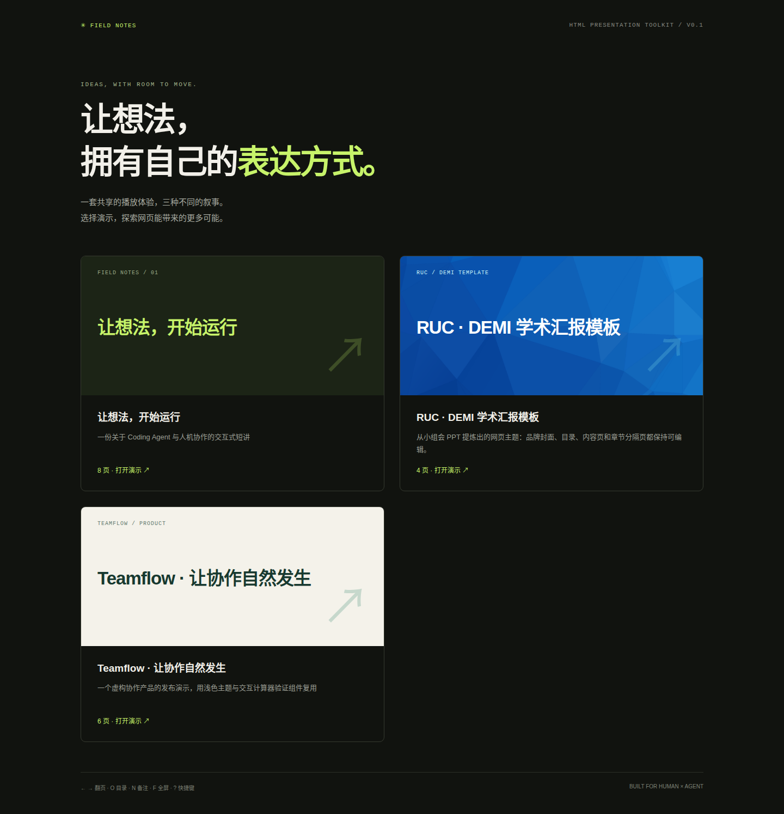
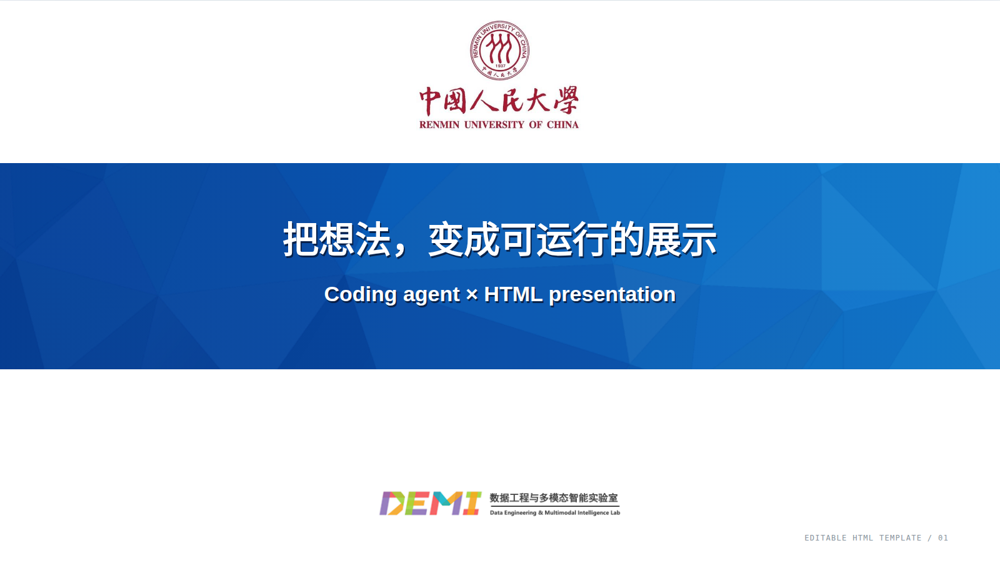
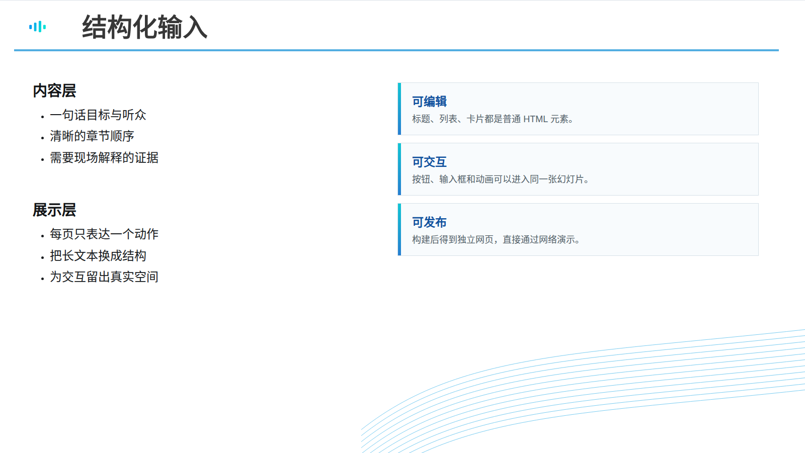

<div align="center">

# Field Notes · HTML 幻灯片工具箱

**用 coding agent 写语义化 HTML，制作可以运行、交互和分享的网页幻灯片。**

无需先把内容塞进传统 PPT 文件。每一页都是可编辑的 HTML，播放体验、键盘控制、目录、讲者备注和构建流程由项目统一提供。

<p>
  <a href="https://github.com/bianyh/html-ppt"></a>
  <a href="https://github.com/bianyh/html-ppt/blob/main/AGENTS.md"></a>
  <a href="https://github.com/bianyh/html-ppt/blob/main/package.json"></a>
</p>



</div>

## 为什么做这个项目

传统 PPT 很适合固定版式的页面，但当展示需要动画、交互计算器、产品界面、可点击流程或实时数据时，编辑成本会迅速上升。HTML 天生适合这些内容，却不适合人类从零开始处理版式、比例、状态和播放控制。

这个项目把两者之间的空白交给 coding agent：人负责目标、受众和材料，agent 负责把内容组织成高可展示性的网页幻灯片。

项目当前聚焦于 **HTML 幻灯片的制作与展示**。网页与可编辑 PPT 之间的双向转换暂不在本版本范围内。

## 视觉预览

RUC / DEMI 学术汇报模板来自项目中的 `小组会汇报模板.pptx`。模板被提炼成可编辑的 HTML 版式：标题、列表、卡片和章节文本都不是截图的一部分。

<table>
  <tr>
    <td width="50%"></td>
    <td width="50%"></td>
  </tr>
</table>

当前目录中的三套演示稿：

- **Coding Agent**：深色主题，讲述人和 coding agent 如何协作，把想法变成可运行的产品。
- **RUC · DEMI 学术汇报模板**：来自小组会 PPT 的蓝色学术汇报主题，包含封面、目录、内容页和章节分隔页。
- **Teamflow**：浅色产品发布演示，包含一个可操作的情景估算器。

## 快速开始

要求 Node.js 20 或更新版本。

```bash
git clone https://github.com/bianyh/html-ppt.git
cd html-ppt
npm install
npm run dev
```

开发服务器会输出本机和局域网访问地址。默认端口会在 60 分钟后自动释放，也可以通过参数调整：

```bash
npm run dev -- --port 9000 --ttl 30
# 只允许本机访问
npm run dev -- --host 127.0.0.1
```

打开服务器输出的 `gallery.html`，从目录进入任意演示稿。播放时可以使用：

| 操作 | 功能 |
| --- | --- |
| `←` `→` / `Space` | 上一页 / 下一页 |
| `Home` / `End` | 第一页 / 最后一页 |
| `O` | 打开页面目录 |
| `N` | 打开讲者备注 |
| `F` | 全屏 |
| `1`–`9` | 跳到对应页面 |

## 用 coding agent 制作演示

先把下面的信息告诉 agent：

1. 观众是谁，以及演示要支持什么决定。
2. 演示时长和观众应该记住的一句话。
3. 必须出现的证据、数据、图片或现场操作。
4. 视觉方向，以及需要的动画或交互。

然后让 agent 阅读 [`AGENTS.md`](AGENTS.md)，并按照 [`docs/SLIDE-BRIEF.md`](docs/SLIDE-BRIEF.md) 和 [`docs/COMPONENTS.md`](docs/COMPONENTS.md) 创建演示稿。

### 创建一套新演示

```bash
npm run new:deck -- my-talk "我的演示"
```

这个命令会创建：

```text
decks/my-talk/deck.json
decks/my-talk/slides/01-opening.html
```

之后只修改 `decks/<id>/` 下的源文件，根目录的 HTML 由构建脚本生成：

```bash
npm run build
npm run check
npm test
```

## 模板和主题

每套 deck 在 `deck.json` 中声明自己的主题、样式、交互脚本和页面顺序。项目现有的 `field`、`studio` 和 `ruc-demi` 主题共享同一个播放运行时，因此不同视觉风格仍然拥有相同的目录、备注、键盘和触摸控制。

### 复用 RUC / DEMI 模板

从 [`decks/ruc-demi/`](decks/ruc-demi/) 复制一份作为学术汇报 deck 的起点，重点修改：

- [`deck.json`](decks/ruc-demi/deck.json)：标题、品牌、页面顺序和输出文件名。
- [`slides/`](decks/ruc-demi/slides/)：可编辑的标题、目录、正文、卡片和备注。
- [`deck.css`](decks/ruc-demi/deck.css)：蓝色横幅、目录线、章节图标和页脚波纹。
- [`assets/`](decks/ruc-demi/assets/)：人民大学、DEMI 和模板装饰素材。

模板中的文字没有烘焙进背景图片。只把 Logo 和装饰作为本地图片资源，方便 agent 在不破坏品牌版式的情况下继续编辑内容。

## 项目结构

```text
decks/<id>/deck.json          deck 元数据、主题、页面顺序
decks/<id>/slides/*.html      一页一个语义化 section.slide
decks/<id>/*.css              deck 专属版式和视觉规则
decks/<id>/assets/            本地图片、Logo 和装饰素材
runtime/                      所有 deck 共用的浏览器播放运行时
styles/                       主题令牌、布局、组件、控件和 gallery 样式
templates/                    页面生成模板
scripts/                      构建、检查、预览和新建 deck 的脚本
tests/                        Chromium 浏览器测试
```

每一页都需要稳定的 `id`、`data-title`、`data-notes`、`aria-label` 和主要标题。完整约定见 [`AGENTS.md`](AGENTS.md)。

## 常用命令

| 命令 | 用途 |
| --- | --- |
| `npm run dev` | 启动开发服务器并监听源文件变化 |
| `npm run preview` | 启动一次性预览服务器 |
| `npm run build` | 生成根目录 HTML 入口 |
| `npm run package` | 生成可独立发布的 `dist/` 目录 |
| `npm run check` | 检查 HTML、资源、元数据和脚本语法 |
| `npm test` | 运行 Playwright 浏览器测试 |
| `npm run new:deck -- <id> <title>` | 创建一套新的演示稿 |

## 当前状态

- 已支持语义化 HTML 幻灯片、多个主题和本地资源。
- 已支持键盘、触摸、全屏、页面目录和讲者备注。
- 已支持 deck 级别的交互脚本，例如 Teamflow 的情景计算器。
- 已支持本机和局域网预览，默认 60 分钟自动释放端口。
- 暂未实现 HTML 与可编辑 PPT 之间的双向转换。

## 验证

在提交前运行：

```bash
npm run build
npm run check
npm test
```

当前测试覆盖三套演示稿的加载、翻页、目录、备注、画布边界、移动端缩放、交互行为和外部请求检查。

## License

License 尚未确定。仓库中的人民大学和 DEMI 品牌素材来自项目提供的模板文件，仅用于该模板的网页复现和演示，请勿将品牌素材单独用于其他用途。
